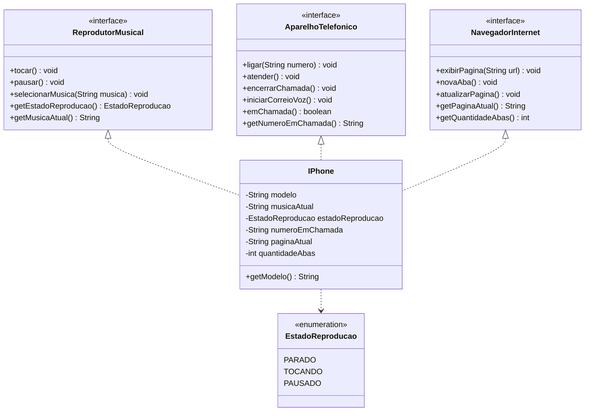

# Modelando o iPhone com UML e Java

Desafio de projeto: modelar e implementar o iPhone representando os três
papéis anunciados por Steve Jobs no lançamento original — **um iPod, um
telefone e um comunicador de internet** — usando interfaces, orientação a
objetos e um diagrama de classes UML.

> "An iPod, a phone, and an internet communicator. An iPod, a phone...
> are you getting it? These are not three separate devices. This is one
> device." — Steve Jobs, 2007

Além do mínimo pedido pelo desafio, esta versão vai um passo além: cada
papel mantém **estado real**, as entradas são **validadas**, e todo o
comportamento é coberto por **testes automatizados (JUnit 5)**.

## Os três papéis

| Papel | Interface Java | Operações principais |
|-------|----------------|----------------------|
| Reprodutor Musical (iPod) | `ReprodutorMusical` | `selecionarMusica`, `tocar`, `pausar` |
| Aparelho Telefônico (phone) | `AparelhoTelefonico` | `ligar`, `atender`, `encerrarChamada`, `iniciarCorreioVoz` |
| Navegador na Internet (internet communicator) | `NavegadorInternet` | `exibirPagina`, `novaAba`, `atualizarPagina` |

A classe `IPhone` **implementa as três interfaces** ao mesmo tempo. É
isso que permite tratar um único objeto como se fosse qualquer um dos
três dispositivos, exatamente como na ideia do "3 em 1".

## Estado e validação

Diferente de uma demonstração que só imprime texto, cada operação
respeita o estado interno do dispositivo:

- **Música**: `pausar()` só funciona se algo estiver tocando; `tocar()`
  exige uma música selecionada. O estado é modelado pelo enum
  `EstadoReproducao` (`PARADO`, `TOCANDO`, `PAUSADO`).
- **Telefone**: não é possível iniciar uma nova chamada com outra em
  andamento; `atender()` exige uma chamada ativa.
- **Internet**: `atualizarPagina()` exige uma página aberta; `novaAba()`
  controla a contagem de abas.

Entradas nulas ou em branco são rejeitadas com `IllegalArgumentException`,
e operações inválidas para o estado atual lançam `IllegalStateException`.

## Diagrama UML

O diagrama de classes está em [`uml/diagrama.md`](uml/diagrama.md)
(formato Mermaid, renderiza direto no GitHub) e em
[`uml/diagrama.puml`](uml/diagrama.puml) (formato PlantUML).



## Estrutura do projeto

Layout Maven padrão:

```
iPhone_UML/
├── README.md
├── .gitignore
├── pom.xml                       # build + dependências (JUnit 5)
├── mvnw / mvnw.cmd / .mvn/       # Maven Wrapper (não exige Maven instalado)
├── src/
│   ├── main/java/com/github/desafio/iphone/
│   │   ├── ReprodutorMusical.java    # interface - papel de iPod
│   │   ├── AparelhoTelefonico.java   # interface - papel de telefone
│   │   ├── NavegadorInternet.java    # interface - papel de navegador
│   │   ├── EstadoReproducao.java     # enum de estado da reprodução
│   │   ├── IPhone.java               # classe que implementa as 3 interfaces
│   │   └── Main.java                 # demonstração de uso
│   └── test/java/com/github/desafio/iphone/
│       └── IPhoneTest.java           # testes JUnit dos três papéis
└── uml/
    ├── diagrama.md               # diagrama Mermaid
    └── diagrama.puml             # diagrama PlantUML
```

## Como executar

Pré-requisito: JDK 17 ou superior (`java -version`). **Maven não precisa
estar instalado** — o Maven Wrapper (`mvnw`) baixa a versão correta
automaticamente.

```bash
# Rodar os testes
./mvnw test            # Linux / macOS
.\mvnw.cmd test        # Windows (PowerShell)

# Compilar e rodar a demonstração
./mvnw compile
java -cp target/classes com.github.desafio.iphone.Main
```

### Saída esperada da demonstração

```
=== Demonstração: iPhone (2007) ===

>> Como Reprodutor Musical
[Música] Música selecionada: Sgt. Pepper's Lonely Hearts Club Band
[Música] Reproduzindo: Sgt. Pepper's Lonely Hearts Club Band
[Música] Reprodução pausada: Sgt. Pepper's Lonely Hearts Club Band
   estado atual: PAUSADO

>> Como Aparelho Telefônico
[Telefone] Ligando para +55 11 99999-0000...
[Telefone] Chamada atendida: +55 11 99999-0000
[Telefone] Chamada encerrada: +55 11 99999-0000

>> Como Navegador na Internet
[Internet] Abrindo a página: https://www.apple.com
[Internet] Nova aba adicionada (total: 2).
[Internet] Abrindo a página: https://www.dio.me
[Internet] Atualizando a página: https://www.dio.me
   abas abertas: 2

>> Validação e estado em ação
   erro esperado: Nada está tocando no momento.
   erro esperado: O campo 'musica' não pode ser nulo nem vazio.

=== Fim da demonstração ===
```

## Testes

São 15 testes cobrindo os três papéis, o controle de estado, as regras de
validação e o polimorfismo (o mesmo objeto visto pelos três tipos).

```
Tests run: 15, Failures: 0, Errors: 0, Skipped: 0
BUILD SUCCESS
```

## Conceitos de POO aplicados

- **Abstração**: cada papel é descrito por uma interface, que define o
  *contrato* (o que fazer) sem dizer *como* fazer.
- **Encapsulamento**: o estado (`musicaAtual`, `numeroEmChamada`,
  `paginaAtual`, etc.) é privado e só muda através dos métodos, que
  garantem as regras de negócio.
- **Polimorfismo**: na `Main` e nos testes, o mesmo objeto `IPhone` é
  referenciado por três tipos diferentes, e cada referência enxerga
  apenas as operações do seu papel.
- **Herança múltipla de tipo**: Java não permite herdar de várias classes,
  mas uma classe pode implementar várias interfaces — é exatamente o que
  torna o "3 em 1" possível aqui.
